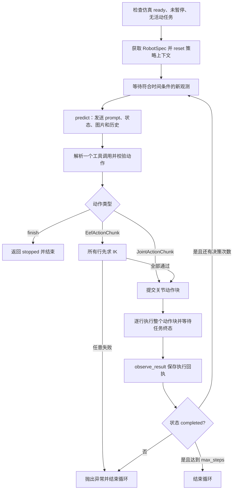

# 机械臂策略库

`isaaclab_policies` 将模型推理和仿真执行分开：每个策略在自己的 Python 文件中实现 `BasePolicy`，通过同一组观测、动作和执行结果类型接入。首个实现为 `gpt.py` 中的 `GPTPolicy`，通过兼容的 Responses API 调用模型，不依赖 OpenAI SDK、Torch、Isaac Sim 或 RoboICL；本地 VLA 可在自己的环境和模块中加载模型。策略名称为 `gpt`，具体模型由 `GPTConfig.model`、JSON 配置的 `model` 或 CLI 的 `--model` 指定，不绑定某一代 GPT。

下面按当前源码说明实际流程。文中的示例指令和动作不是某次真实运行的记录；实际任务文本来自启动时的 `--instruction`。

| 问题 | 当前实现 |
|---|---|
| 给 GPT 的 prompt 是什么？ | 固定控制规则 + `Task` 任务文本 + `RobotSpec` 机器人说明；另外附上当前观测、多相机图像和历史轮次。固定规则原文见下文。 |
| 包含关节状态吗？ | 包含全部关节的名称、实测位置、实测速度和已下发目标，也包含实测末端位姿。 |
| GPT 返回什么？ | 恰好一个工具调用：关节动作块、末端位姿动作块或结束。参数解析成 Python 动作对象后才进入执行器。 |
| 是通过 IK 控制吗？ | 由 GPT 选择动作类型。关节动作直接下发；末端动作先在服务端整块求 IK，再下发关节目标。 |
| 夹爪怎么控制？ | 作为普通具名关节，用 `RobotSpec.grippers` 的 `open` / `close` 映射下发关节位置；不走末端 IK。 |
| 一次推理完就全执行吗？ | 正常情况下，校验通过后按顺序执行本次返回的整个动作块，再获取新观测、再次推理。没有只执行前几行再重规划的逻辑。 |
| 有检查和回退吗？ | 有输入/动作校验、整块 IK 预检查和执行回执；没有自动到位判定、抓取成功判定、碰撞规划或失败后的姿态回退。 |

## 启动 GPT 策略

在仓库根目录，终端一启动仿真：

```bash
bash scripts/demos/web_control/start_simulation.sh
```

等待 `WEB_CONTROL_READY` 和第一帧图像。更新过本目录接口后，需要重启此前正在运行的仿真。网页保持观察模式，Python 策略负责运动。

终端二使用 Python 3.10+。以下 `python` 指你选定的策略环境解释器；不要求和仿真环境相同。先通过自己的凭证管理方式设置 `OPENAI_API_KEY` 或 `ASTRA_API_KEY`，再执行：

```bash
# 仓库内运行脚本会自动定位策略库，不要求先 pip install。
python scripts/demos/web_control/run_policy.py \
  --policy gpt \
  --config source/isaaclab_policies/configs/gpt.json \
  --instruction '读取机器人状态，保持当前姿态，然后结束' \
  --max-steps 3

# 仅推理一次并打印动作，仍会请求模型 API，但不会下发机器人运动。
python scripts/demos/web_control/run_policy.py \
  --policy gpt --instruction '打开前左夹爪' --dry-run
```

任务指令通过 `--instruction` 传入。`--max-steps` 限制策略决策次数；模型返回结束指令时提前退出。`--url` 默认 `http://127.0.0.1:8080`。HTTP 服务仅监听回环地址，远程策略进程需与网页一样使用 SSH 隧道。

策略发送全部相机 RGB 与同帧机器人状态到配置的模型 endpoint。模型提出的动作可能无法完成任务，接口测试通过不代表抓取成功；建议从小幅运动开始核对本机器人视角和跟踪情况。

独立使用 Python API 时安装：

```bash
python -m pip install -e source/isaaclab_policies
```

`isaaclab.sh --install` 也会发现该包的 `setup.py`。`RobotAdapter` 接收现有 `RobotClient` 对象；远程使用时可复制 `scripts/demos/web_control/robot_client.py`，它只依赖标准库。

```python
from robot_client import RobotClient
from isaaclab_policies import GPTConfig, GPTPolicy, PolicyRunner, RobotAdapter

robot = RobotAdapter(RobotClient("http://127.0.0.1:8080", timeout=30), action_timeout=120)
policy = GPTPolicy(GPTConfig())
results = PolicyRunner(policy, robot, observation_timeout=30).run(
    instruction="保持当前姿态，然后结束",
    max_steps=3,
)
```

## 实际发送给 GPT 的内容

入口是 [gpt.py](isaaclab_policies/gpt.py) 的 `GPTPolicy.reset()`、`_observation_message()` 和 `_build_payload()`。请求的主要结构如下（示意，变量代表运行时数据）：

```python
{
    "instructions": INSTRUCTIONS + "\nTask: " + instruction + "\nRobotSpec: " + robot_spec_json,
    "input": [
        # 最近 history_steps 个完整历史轮次，然后是本轮 user 消息：
        # 历史观测/图片 → 模型工具调用 → function_call_output 执行回执
        ...,
        {
            "role": "user",
            "content": [
                {"type": "input_text", "text": current_state_json},
                {"type": "input_text", "text": "Camera: <相机名称>"},
                {"type": "input_image", "detail": "high", "image_url": "data:image/jpeg;base64,..."},
                # 对 RobotSpec.cameras 中的每个相机重复名称和图像
            ],
        },
    ],
    "tools": [...],  # execute_joint_chunk、可用时的 execute_eef_chunk、finish
    "tool_choice": "required",
    "parallel_tool_calls": False,
    "stream": False,
    "store": False,
    # 另有 model、reasoning、max_output_tokens 等配置
}
```

### 固定控制规则原文

当前 `INSTRUCTIONS` 的完整内容是：

```text
You control a simulated robot using only RGB images and measured robot state.
Follow the task instruction and reobserve after each short action chunk. Use exactly one tool per turn.
Joint targets are ABSOLUTE values in each joint's native unit (rad or m), in the explicit joint_names column order.
Grippers are ordinary named joints: use the supplied open/close maps, including coupled joints and opposite signs.
EEF positions are ABSOLUTE flange positions in the selected arm's BASE frame, in metres; quaternions are unit wxyz.
EEF targets refer to the flange, not the finger contact centre. They are NOT world coordinates or delta poses.
Use images and the supplied base/flange definitions; do not assume calibrated camera extrinsics are available.
Each row is held for steps_per_action * physics_dt simulation seconds. Targets are NOT automatically interpolated.
Generate small, smooth changes and enough intermediate points; only named joints change, others retain their targets.
There is no automatic collision planning. EEF IK convergence and completed chunks do not guarantee physical arrival.
Use measured positions and execution errors to evaluate progress, not only previously commanded targets.
finish ends this policy loop and leaves the robot holding its last targets; it is not a measured success signal.
No world object positions, rewards or success ground truth are available.
Do not claim a grasp from tool completion alone.
```

随后追加 `Task: <你的 --instruction>` 和 `RobotSpec: <JSON>`。这里没有写死“抓取”的任务 prompt，也没有自动拆分成接近、闭爪、抬升等阶段；这些决策由模型根据任务和观测产生。

### 机器人说明、当前状态和历史

`RobotSpec` 通过 `GET /api/robot/spec` 获取，在 `reset()` 时保存。它包含 `name`、`joint_names`、`controllable_joint_names`、`limits`、`joint_units`、`grippers`、`arms`、`cameras`、`physics_dt`。关节限位与全部关节名对齐，被动关节无限限位用 `null` 表示；可控关节的单位和有限限位必须有效。`arms` 提供基座、法兰定义、关节链及 IK 容差；`grippers` 提供夹爪名称、单位及开闭映射。

每轮 `input_text` 的状态 JSON 包含以下字段：

| 字段 | 发给模型的含义 |
|---|---|
| `sequence` | 图像采集序号，用来区分新旧观测。 |
| `sim_time` | 此次采集对应的仿真时间，单位秒。 |
| `captured_at` | 此次采集的 Unix 墙钟时间戳。 |
| `joint_names` | 全部关节名，包括夹爪及被动关节；可控范围由 `RobotSpec` 另行指定。 |
| `positions` | 同帧实测关节位置，按 `joint_names` 排列；可控关节原生单位为 rad 或 m。 |
| `velocities` | 同帧实测关节速度，对应 rad/s 或 m/s。 |
| `targets` | 同帧已施加的关节位置目标，与实测 `positions` 是两个不同量。 |
| `eef_poses` | 每只支持 EEF 的臂的实测法兰位姿：臂基座坐标系下的位置和 wxyz 四元数。 |

**因此 GPT 能看到关节状态，不只是图像，也不只是上一次命令。** 图片作为独立的 `input_image` 传入：每个相机的名称 + JPEG 的 base64 data URL，`detail="high"`。图像、关节状态和末端位姿属于同一次采集；策略没有接收深度图、标定相机外参、物体世界坐标、奖励或任务成功真值。底层仿真中的 `object_states` 没有进入 `PolicyObservation`。

默认 `history_steps=4`，保留最近 4 个完整的“观测及图片 → 模型返回 → 执行回执”轮次。下一次请求会带上这些历史和当前新观测；`observe_result()` 本身只是保存回执，不会立即再调用 GPT。设为 0 时只发送当前观测。`preserve_reasoning=true` 时还保留并回传加密 reasoning 项，不解密内部推理；Lingzhi 示例配置将其关闭。

## GPT 返回什么，以及怎样下发

模型必须返回恰好一个 `function_call`，不能在同一轮同时返回“移动末端”和“闭合夹爪”两个工具调用。Responses 响应可能还包含其他输出项，但控制器只把工具调用的 JSON `arguments` 转成动作对象，不把普通文本当作控制命令。

| 工具名 | 转换后的对象 | 必填参数 | 执行路径 |
|---|---|---|---|
| `execute_joint_chunk` | `JointActionChunk` | `joint_names`、`positions`、`steps_per_action` | 直接提交关节目标，允许同一块控制多臂和夹爪。 |
| `execute_eef_chunk` | `EefActionChunk` | `arm`、`positions`、`quaternions`、`steps_per_action` | 单只臂的法兰目标，服务端先求 IK。机器人没有可用 `arms` 时不提供该工具。 |
| `finish` | `StopAction` | `reason` | 不提交运动，产生本地 `stopped` 回执并结束策略循环。 |

例如 Cobot 前左夹爪张开的模型返回可以是：

```json
{
  "type": "function_call",
  "call_id": "call_example_1",
  "name": "execute_joint_chunk",
  "arguments": "{\"joint_names\":[\"fl_joint7\",\"fl_joint8\"],\"positions\":[[0.04,-0.04]],\"steps_per_action\":12}"
}
```

解析后就是 `JointActionChunk(["fl_joint7", "fl_joint8"], [[0.04, -0.04]], 12)`。`call_id` 用来配对稍后的执行回执。`predict()` 返回的是该动作对象；真正发送机器人 HTTP 请求的是 `RobotAdapter.execute()`。

### 关节控制与 IK 的区别

关节路径为：

```text
GPT execute_joint_chunk → JointActionChunk → RobotAdapter
→ RobotClient.execute_joint_chunk → POST /api/robot/chunks
→ RobotServer.execute_joint_chunk → 仿真逐步施加关节位置目标
```

这里的 `positions=[T,N]` 是绝对关节位置，列与显式的 `joint_names` 一一对应。**此路径不调用 IK**，也不是力矩命令。

末端路径为：

```text
GPT execute_eef_chunk → EefActionChunk → RobotAdapter
→ RobotClient.execute_eef_chunk → POST /api/robot/eef/chunks
→ EefControl.execute_eef_chunk：对全部 T 行求 IK
→ RobotServer.execute_joint_chunk：提交求出的 [T,N] 关节目标
→ 同一套关节执行流程
```

`positions=[T,3]` 单位为米，`quaternions=[T,4]` 是单位四元数 wxyz。位姿定义为**所选臂基座到法兰**的变换，不是世界坐标、增量位姿或夹爪接触中心。Franka、X5、X5 双臂和 Cobot 支持 EEF；A2D 当前仅支持关节动作。

IK 在仿真服务端的 [eef_control.py](../../scripts/demos/web_control/eef_control.py) 和 [kinematics.py](../../scripts/demos/web_control/kinematics.py) 中完成，并非 GPT 自己计算后调用独立 `/ik` 接口：

1. 第一行使用服务端当时的实测关节位置作为 seed，先裁到关节限位内；后续行使用上一行的 IK 解作为 seed。
2. 用带关节上下界的 SciPy `least_squares(method="dogbox")` 求解。每行检查位置误差不超过 `1e-4 m`、旋转误差不超过 `1e-3 rad`。
3. **全部行求解成功后，才创建运动任务。任意一行失败，本次整个 EEF 块都不提交**，不会先执行前几行再发现后面不可解。

这些容差检查的是运动学解的精度，不是执行后机器人的实际到位误差。IK 没有碰撞规划、轨迹插值或相邻解跳变阈值检查。

### 夹爪控制

GPT 没有单独的 `open_gripper` 工具，也没有通用的 0～1 开度字段。它从 `RobotSpec.grippers` 读取开闭映射，生成普通 `execute_joint_chunk`。以当前 [Cobot profile](../../scripts/demos/web_control/robot/cobot_magic.py) 为例：

| 夹爪 | 关节列 | 张开 `positions` | 闭合 `positions` | 单位 |
|---|---|---|---|---|
| 前左 `fl` | `["fl_joint7", "fl_joint8"]` | `[[0.04, -0.04]]` | `[[0.0, 0.0]]` | m |
| 前右 `fr` | `["fr_joint7", "fr_joint8"]` | `[[0.04, -0.04]]` | `[[0.0, 0.0]]` | m |
| 后左 `bl` | `["bl_joint7", "bl_joint8"]` | `[[0.04, -0.04]]` | `[[0.0, 0.0]]` | m |
| 后右 `br` | `["br_joint7", "br_joint8"]` | `[[0.04, -0.04]]` | `[[0.0, 0.0]]` | m |

两指的符号相反，模型应按映射显式写出相关关节。执行器不会替漏写的关节自动补齐映射，也不额外检查夹爪联动关系；未指定的关节保持原目标。A2D 夹爪则由多个以 rad 为单位的关节联动，不能套用 Cobot 的数值。

EEF 块只改变所选臂的关节，夹爪保持原目标。因此“末端靠近 → 闭爪 → 抬升”通常需要多轮动作和观测；同一个 `JointActionChunk` 也可以显式包含机械臂和夹爪关节，使它们在同一行一起更新。当前没有基于接触力或抓取成功检测来自动停止闭爪的策略逻辑。

## forward / predict 循环和执行时序

本库没有名为 `forward()` 的策略入口。这里对应的单次模型推理函数是 `GPTPolicy.predict()`；外层循环在 [runner.py](isaaclab_policies/runner.py) 的 `PolicyRunner.run()`。



图中展示主路径；任一阶段的未处理异常也会退出，`finally` 总会调用 `policy.close()`。`reset()` 清空策略历史，不重置场景或机器人姿态。主循环可概括为：

```python
robot.check_ready()
policy.reset(instruction, robot.get_robot_spec())
sequence, min_sim_time = 0, 0.0
for step in range(max_steps):
    obs = wait_for_observation(sequence, min_sim_time)
    action = policy.predict(obs)           # 同步等待本次 GPT 完整响应
    result = robot.execute(action)         # 同步等待整个动作块的任务终态
    policy.observe_result(result)          # 写入下一轮会携带的执行回执
    if isinstance(action, StopAction):
        break
    if result.status != "completed":
        raise RuntimeError("policy loop stopped")
    sequence = obs.sequence
    min_sim_time = result.finished_sim_time
# 实际代码通过 finally 调用 policy.close()，异常路径也会清理。
```

### 一次模型输出到底执行多少

假设模型输出 `T=8` 行，`steps_per_action=12`，服务端 `physics_dt=1/120 s`：

- 每行保持 12 个物理步，即 `0.1` 仿真秒；正常完成整块需要 `8 × 12 = 96` 个物理步，即 `0.8` 仿真秒。
- 执行器会依次执行全部 8 行，第 12、24、36……个物理步之后切换下一行；不会自动只取第一行或前几行。
- 块内不再次调用 GPT，也不会逐行等待“误差足够小”才进入下一行。相机和状态仍在更新，但策略要等块结束才使用新观测。
- `steps_per_action` 是保持目标的步数，不是插值数量。chunk 执行时绕过手动控制的目标平滑，不自动生成中间点；“小幅、平滑”是 prompt 给模型的要求，不是执行器的强制保证。

`T` 由本次输出决定，默认 `max_chunk_size=32` 只是行数上限，并不要求每轮返回 32 行。`--max-steps` 限制模型决策轮数，`finish` 也占一轮；它不是物理步数。`--action-timeout` 等待任务的超时按墙钟秒计，与上面的仿真时长不同。

底层 [robot_server.py](../../scripts/demos/web_control/robot_server.py) 的 `consume()` 按 `executed_steps // steps_per_action` 选当前行；[run.py](../../scripts/demos/web_control/run.py) 每个物理步调用 `set_joint_position_target()`、写入仿真并 `sim.step()`，随后 `publish()` 更新实测状态和已执行步数。它是位置目标驱动，并不直接把机器人瞬移到每行目标；底层执行器是否跟上目标取决于实际动力学。

下一轮观测必须同时满足 `sequence > 上一轮观测序号` 和 `sim_time + 1e-8 >= 上一动作结束时间`。因此循环会跳过结束前的旧帧，但**没有额外的到位等待时间**。GPT 推理期间仿真继续运行、保持最后目标；推理完成后也没有基于“观测已经过了多久/状态变化多少”的额外复核。

### 执行回执与闭环的边界

每个动作块结束后返回 `ActionResult`，含 `task_id`、`status`、`executed_steps`、`finished_sim_time`。发回模型的 `function_call_output` 还包含 `feedback` 中的：

- `joint_names`：本次实际控制的关节。
- `actual_positions`：结束时这些关节的实测位置。
- `targets`：最后施加的目标。
- `errors`：`targets - actual_positions`，单位与对应关节一致。
- `reason`：存在时传入，例如 `finish` 的原因。

EEF 路径的回执同样是 IK 后所控制关节的实际位置和误差；下一帧观测另外提供实测 `eef_poses`。`completed` 的条件仅为 `executed_steps == T * steps_per_action`，误差很大仍可能是 `completed`。

当前是**动作块之间使用新观测和回执进行决策**的闭环。模型可以在下一轮根据图像和误差调整动作，但执行器本身没有“误差超过阈值就重做”的规则；这也不是每个物理步由 GPT 反馈控制。

## 目前有哪些检查，失败后会不会回退

| 阶段或情况 | 已实现的检查/处理 | 后续行为 |
|---|---|---|
| 开始及等待观测 | 检查仿真 ready、未暂停、无活动任务；观测检查关节顺序、维度、有限值、相机集合及末端位姿。 | 不满足则停止；尚无图像的 HTTP 503 和不够新的帧会轮询等待，超过观测超时则退出。 |
| 模型响应 | 必须完整完成、恰好一个已知工具调用、有效且未复用的 `call_id`、合法 JSON 和严格字段。 | 拒绝本次动作，退出；不会自动补全动作或请求 GPT 重试。 |
| 动作提交前 | 策略解析和 Adapter 都校验动作；服务端再次校验。包括可控关节名、维度、有限值、关节限位、行数、步数、臂名、单位四元数等。 | 无效块不提交；不把越限目标自动裁成可执行动作。 |
| EEF 提交前 | 整块 IK 及关节限位、运动学残差检查。 | 任一行失败即拒绝整块并退出；不会把 IK 错误交给 GPT 自动换目标。 |
| 块执行期间 | 记录执行步数、状态；允许取消，仿真停止/报错时活动任务标记 `failed`。 | 没有逐行到位门槛、碰撞预测或抓取结果检查。 |
| 块执行完成 | 返回实际关节位置和误差，等待新帧并交给下一轮模型。 | `completed` 就允许下一轮，不会自动因误差大而撤回或重试。 |
| 任务 `failed` / `cancelled` | Runner 先交给 `observe_result()`，然后抛错。 | 直接终止；虽然本地接收了失败回执，也不会再发起一次 GPT 推理做恢复。 |
| 等待已知任务时超时/异常/Ctrl+C | Adapter 尝试取消自己已经拿到 `task_id` 的任务。 | 随后退出；取消失败不会覆盖原异常。取消只保持最后目标，不回到起始姿态。 |
| 提交运动时 HTTP 超时 | 请求可能已被服务端接受，但客户端没拿到任务 ID。 | 不自动重发，也不猜测并取消其他活动任务；需要检查服务端状态。 |
| GPT 返回 `finish` 或达到 `max_steps` | 结束策略循环、释放策略上下文。 | 保持最后目标；不会自动张爪、回零、撤退或重置仿真，也不代表任务成功。 |

**没有“保存安全姿态 → 执行 → 检查失败 → 自动退回”的机制。** 整块 IK 失败时不提交运动属于执行前拒绝，不是执行后的回退。取消任务也只是阻止剩余行继续下发，当前目标下的物理运动仍可能继续；不是物理急停。服务端网络不可达时不能保证取消成功。

当前也没有独立的视觉成功判定器、碰撞规划器、失败恢复状态机或动作自动重试。正常 `completed` 后由 GPT 自行判断下一步，`finish` 的原因仅是模型声明。实际运行时应避免其他客户端同时移动或重置同一机器人。

## 类名和接口

| 类或函数 | 公共接口 |
|---|---|
| `BasePolicy` | `reset(instruction: str, robot: RobotSpec) -> None` |
| | `predict(observation: PolicyObservation) -> PolicyAction` |
| | `observe_result(result: ActionResult) -> None` |
| | `close() -> None` |
| `RobotAdapter` | `get_robot_spec() -> RobotSpec`、`get_observation() -> PolicyObservation`、`execute(action: PolicyAction) -> ActionResult` |
| `PolicyRunner` | `run(instruction: str, max_steps: int) -> list[ActionResult]` |
| `create_policy` | `create_policy(name: str, config: dict \| None = None) -> BasePolicy` |

`reset` 初始化策略上下文，不重置仿真。`predict` 只返回动作，不能在模型内部直接调用机械臂。`observe_result` 接收已经执行的回执；无状态 VLA 可以沿用默认空实现。`close` 在正常结束、超时、推理失败和 Ctrl+C 时释放策略资源。

公共数据类型和校验定义在 [types.py](isaaclab_policies/types.py)。Python 动作对象的 `steps_per_action` 默认 1；GPT 工具参数要求模型显式填写该值。`PolicyObservation.images` 在策略进程中是按相机名称索引的 JPEG bytes；VLA 可在自身实现中解码、调整尺寸、归一化。

代码定位：[模型输入与解析](isaaclab_policies/gpt.py)、[决策循环](isaaclab_policies/runner.py)、[下发与等待/取消](isaaclab_policies/robot_adapter.py)、[HTTP 客户端](../../scripts/demos/web_control/robot_client.py)、[服务端关节任务](../../scripts/demos/web_control/robot_server.py)、[EEF 转关节](../../scripts/demos/web_control/eef_control.py)、[仿真物理循环](../../scripts/demos/web_control/run.py)。

## GPT 配置

| 字段 | 默认与含义 |
|---|---|
| `model` | `ASTRA_MODEL` 或 `gpt-6-astra` |
| `endpoint` | `ASTRA_ENDPOINT` 或 `https://api.openai.com/v1/responses`；可指定兼容代理 |
| `api_key_env` | 指定凭证环境变量名称；未指定时先用 `ASTRA_API_KEY`，再用 `OPENAI_API_KEY` |
| `reasoning_effort` | `ASTRA_REASONING_EFFORT` 或 `xhigh` |
| `max_output_tokens` | 16384；包含推理输出预算，可设 `null` 不发送此限制 |
| `timeout` | 240，单次模型 HTTP 超时秒数 |
| `max_chunk_size` | 32，最多预测多少行；EEF 同时受服务端 128 行上限约束 |
| `history_steps` | 4，保留多少个完整“观测、工具调用、执行回执”历史轮次；0 仅使用当前观测 |
| `preserve_reasoning` | `true`；是否回传加密 reasoning 历史。不支持验证该内容的网关设为 `false`，仍保留观测、动作与回执 |

显式 JSON 配置优先于环境默认，CLI 的 `--model`、`--endpoint` 又优先于 JSON。参考 RoboICL 使用的代理模型别名可通过这两个参数配置，不在库中写死。

请求使用非流式 Responses JSON、`store=false`、严格函数 schema、一次一个工具调用。模型不接收机器人控制句柄。仅完整且通过名称、维度、限位及四元数校验的回复才返回动作。历史按完整轮次裁剪，并保留返回的加密 reasoning 项和正确配对的 `call_id`；不记录或解密内部推理。

Lingzhi 网关配置见 `configs/gpt_lingzhi.json`，从 `OPENAI_API_KEY` 读取凭证。实测该网关回传加密 reasoning 时返回 `400 invalid_encrypted_content`，因此此配置显式关闭 `preserve_reasoning`；`high` 推理强度及历史动作/回执保持启用。运行时使用 `--config source/isaaclab_policies/configs/gpt_lingzhi.json`。库不会在 API 错误后自动重试机器人动作。

HTTP 错误、未完成输出、无效动作或 IK 失败会终止本次循环。运动提交不自动重试：提交超时可能已被服务端接受，应检查机器人活动任务后再决定下一次操作。等待已知任务时超时或中断，会尝试取消该任务；网络不可达时不能保证取消成功。取消保持最后目标，不是物理急停。推理期间仿真继续运行。

## 新增 VLA 策略

建立自己的 `my_vla.py` 和类，统一返回上述动作类型。下面示例约定你的模型封装提供 `infer(images, state, instruction)`，返回 `[T,N]` 原生单位的绝对目标；需要将真实模型的归一化/增量输出在此文件内转换。

```python
from isaaclab_policies import BasePolicy, JointActionChunk


class VLAPolicy(BasePolicy):
    def __init__(self, model_factory, checkpoint, steps_per_action=12):
        # 使用 module:function 工厂，让模型与依赖由这个策略自行管理。
        import importlib

        module, name = model_factory.split(":")
        self.model = getattr(importlib.import_module(module), name)(checkpoint)
        self.steps_per_action = steps_per_action

    def reset(self, instruction, robot):
        self.instruction = instruction
        self.joint_names = robot.controllable_joint_names
        self.indices = [robot.joint_names.index(n) for n in self.joint_names]

    def predict(self, observation):
        import io
        from PIL import Image

        images = {name: Image.open(io.BytesIO(jpeg)).convert("RGB") for name, jpeg in observation.images.items()}
        state = [observation.positions[i] for i in self.indices]
        targets = self.model.infer(images, state, self.instruction)
        rows = targets.tolist() if hasattr(targets, "tolist") else targets
        return JointActionChunk(self.joint_names, rows, self.steps_per_action)

    def close(self):
        self.model = None
```

将模块放入策略环境的 `PYTHONPATH`，配置 JSON 提供 `model_factory`、`checkpoint` 等构造参数：

```bash
python scripts/demos/web_control/run_policy.py \
  --policy my_vla:VLAPolicy --config /path/to/vla.json \
  --instruction '执行任务' --max-steps 20
```

库不会修改执行器来适配某个模型，也不会提前导入 Torch、Transformers 或具体 VLA 框架。

## 验证

```bash
python -m pytest -q source/isaaclab_policies/tests scripts/demos/web_control/tests
```

测试包含本地 Responses HTTP 服务、真实 WebServer/RobotClient 和模拟物理步进的多轮集成；不调用付费模型或启动 GPU。实际配置模型的访问权限、运行速度和物理任务成功率需在目标环境单独验证。

参考：[OpenAI function calling](https://developers.openai.com/api/docs/guides/function-calling)、[Responses API](https://developers.openai.com/api/reference/resources/responses/methods/create)。设计参考 RoboICL 的 Responses 工具调用与回执流程，没有迁移其固定双臂 `[T,14]`、世界坐标增量、示范检索或评测框架。
